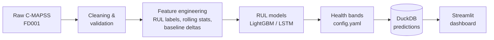
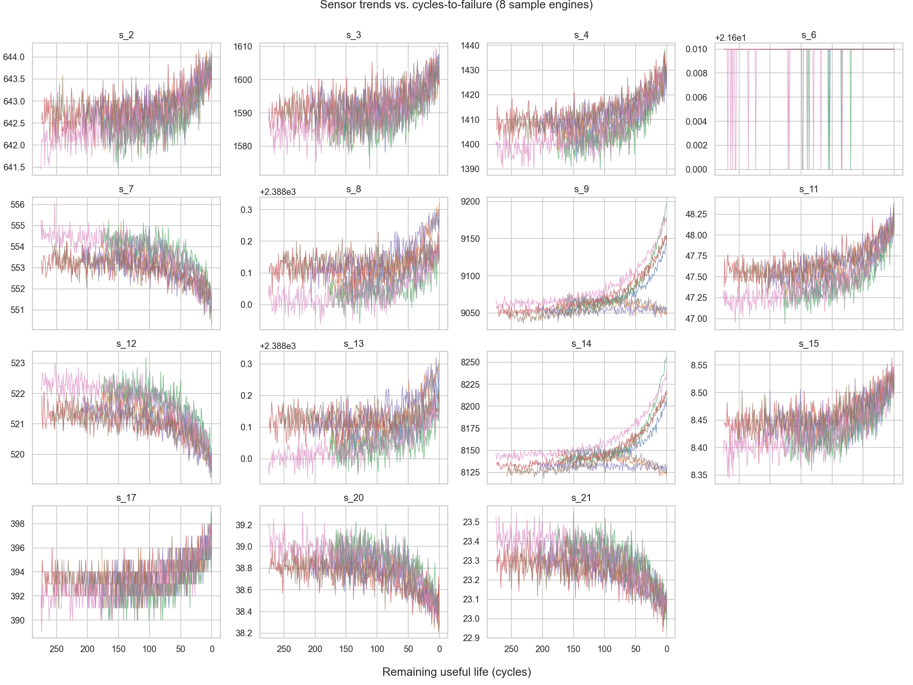
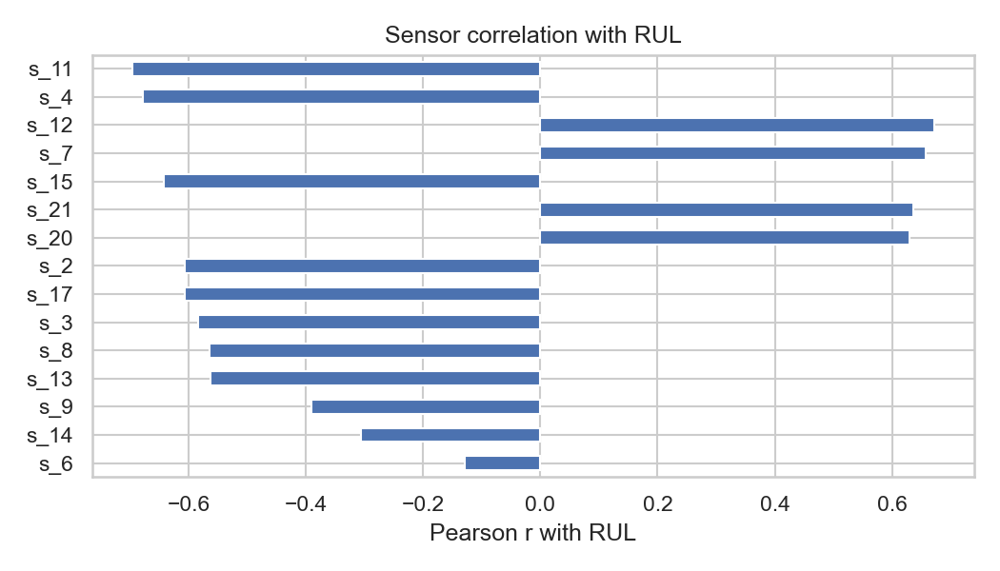

# Aircraft Predictive Maintenance

End-to-end predictive maintenance on NASA's C-MAPSS turbofan data: predict each
engine's **Remaining Useful Life (RUL)**, translate it into a health status, and
surface a prioritized maintenance queue in a dashboard.

**Headline result (FD001, 100 test engines):** LightGBM reaches **RMSE 15.0**
cycles and a NASA score of **322**, using a 77-feature pipeline with no leakage
across engines.

## Problem and business value

Unplanned engine failures are costly and unsafe, while fixed-interval
maintenance throws away useful life. Estimating RUL from sensor data lets a
maintenance team:

- **Prioritize**: see which engines need attention first, ranked by remaining life.
- **Plan**: act on Warning-level engines before they become Critical.
- **Trade off cost and risk**: the NASA score used here penalizes late
  predictions (believing an engine has more life than it does) more than early
  ones, matching the safety-first asymmetry of the problem.

## Architecture



```
data/{raw,processed}   datasets (git-ignored)
notebooks/             EDA
src/data               loading, validation, constant-column removal
src/features           RUL labels, normalization, rolling and baseline features
src/models             metrics, LightGBM baseline, windowing, LSTM
src/health             RUL -> status bands, maintenance ranking
src/storage            DuckDB read/write
src/predict.py         batch scoring
dashboard/             Streamlit app
tests/                 33 unit tests
```

## Data and degradation analysis

NASA C-MAPSS FD001: 100 training engines run to failure, 100 test engines
truncated before failure, one operating condition, one fault mode. After
cleaning, 7 constant columns are dropped, leaving 15 sensors. Engines fail after
128 to 362 cycles (mean 206). See `notebooks/01_eda.ipynb`.

| Sensor trends vs. cycles to failure | Sensor correlation with RUL |
|---|---|
|  |  |

## Method

- **Labels:** RUL = last cycle minus current cycle, capped at 125 (the usual
  piece-wise linear target; early-life degradation is not observable).
- **Features:** min-max normalization fitted on train only; per-engine rolling
  mean, std and slope over 10 cycles; deviation from each engine's own
  first-20-cycle baseline. All causal and computed per engine, with unit tests
  that nothing crosses engine boundaries.
- **Validation:** 80/20 split by engine, never by row.
- **Test metric:** last observed cycle of each test engine against the official
  `RUL_FD001.txt`; RMSE and the asymmetric NASA score.

## Results

| Model | Test RMSE | Test NASA score |
|-------|-----------|-----------------|
| **LightGBM** (77 features) | **15.01** | **321.9** |
| LSTM (2x64, 30-cycle windows, 15 sensors) | 15.18 | 431.4 |

- RMSE is effectively tied; with 100 test engines the gap is within noise.
- The NASA score favors LightGBM: the LSTM over-estimates remaining life more
  often on some engines, which the score punishes exponentially.
- LightGBM sees engineered history features; the LSTM sees only normalized
  sensors. On a dataset this small the hand-built features are worth about as
  much as the sequence model's learned memory.
- LightGBM is the selected model (`models/best_model.json`). The LSTM is
  untuned, so there is likely headroom.

Validation RMSE on all cycles is 11.0. Validation RMSE on last cycles (about 3)
is not comparable, because training engines end at RUL 0, which is easy.

## Health status and maintenance

`config.yaml` defines the bands on predicted RUL: **Critical** < 20,
**Warning** < 50, **Watch** < 80, otherwise **Healthy**. Engines in Critical or
Warning form the maintenance queue, ranked by lowest RUL. On the FD001 test set:
14 Critical, 18 Warning, 17 Watch, 51 Healthy.

## Dashboard

```bash
make predict
make dashboard      # streamlit run dashboard/app.py
```

- **Fleet overview:** engine counts per health band.
- **Maintenance queue:** Critical and Warning engines, lowest RUL first.
- **Engine drill-down:** predicted vs. true RUL curve with band thresholds, and
  selectable sensor trends.

*(Screenshots to be added in `docs/images/`.)*

## Setup and run

Place the C-MAPSS files (`train_FD001.txt`, `test_FD001.txt`, `RUL_FD001.txt`;
download from NASA's prognostics data repository) in `data/raw/`.

```bash
make setup && source .venv/bin/activate   # full environment (incl. PyTorch)
make features      # clean data and build features
make baseline      # train LightGBM, print metrics
make lstm          # optional: train the LSTM
make predict       # score all engines into data/processed/predictions.duckdb
make dashboard     # launch the dashboard
make test && make lint
```

LightGBM on macOS needs the OpenMP runtime: `brew install libomp`.

Lighter installs: `requirements-app.txt` (pipeline and dashboard) or
`requirements-dev.txt` (adds pytest and ruff). CI (`.github/workflows/ci.yml`)
runs ruff and pytest on every push; there is a `Dockerfile` for the dashboard
(mount `data/` and `models/` at run time) and pre-commit hooks
(`pre-commit install`).

## Limitations

- **Simulated, single-condition data:** FD001 only (one operating condition, one
  fault mode). Real fleets have mixed conditions and faults. FD002 to FD004 are
  loaded by the raw reader but not modeled.
- **Model selection used the test set:** the baseline and LSTM were compared on
  test metrics, and the chosen one is reported on the same data. Results are
  from one seed and 100 engines, so small differences are not meaningful.
- **Point predictions only:** no uncertainty intervals, which matter for
  maintenance decisions.
- **Health thresholds are illustrative:** 20/50/80 cycles were chosen by hand,
  not derived from real maintenance lead times or costs.
- **Capped target:** predictions never exceed 125 cycles.
- **Batch, static scoring:** the dashboard reads a DuckDB snapshot; there is no
  streaming ingestion or API.

## Future work

- Quantile regression or conformal prediction intervals.
- Tune the LSTM and try a CNN or transformer; ensemble with LightGBM.
- Extend to FD002/FD004 with per-operating-condition normalization.
- Choose thresholds from cost and lead-time analysis.
- FastAPI `/predict` endpoint and scheduled scoring.

## License

MIT
